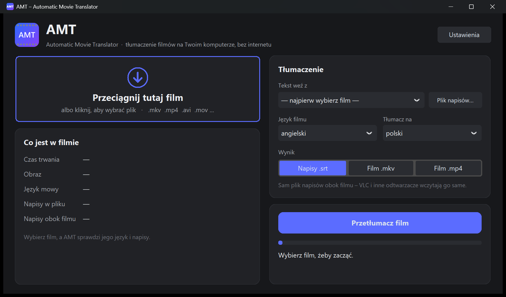

# AMT – Automatic Movie Translator

**English** · [Polski](README.md)

A movie translator that runs **entirely on your own computer** (Windows, macOS, Linux).
Drop in a movie: AMT detects its language and subtitles, translates them and saves `.srt` subtitles
or a finished movie with subtitles (`.mkv` or `.mp4`).

No accounts and no cloud: nothing is sent to the internet. A connection is needed only once,
to download the libraries and models.



> For live viewing (Netflix, YouTube, VLC) use the companion app
> **AMTSB – Automatic Movie Translator SuBtitles**: it covers on-screen subtitles with the translation.

## Features

- **Detects** the spoken language (Whisper), subtitles embedded in the file (MKV/MP4 text tracks)
  and subtitle files next to the movie (`Movie.en.srt` etc.).
- **Translates**:
  - existing subtitles from the movie or from a `.srt` / `.ass` / `.vtt` file. This is the fastest and most accurate
    option: a whole movie in 1–3 minutes;
  - speech, when the movie has no subtitles at all: it recognizes the dialogue and creates subtitles from scratch.
- **Saves**:
  - `Movie.pl.srt`, which VLC and other players load automatically;
  - `Movie [PL].mkv`, the movie with an added subtitle track: no re-encoding, no quality loss;
  - `Movie [PL].mp4` with subtitles burned into the picture, which plays on any TV or phone.
    The picture is encoded on the graphics card when available (Intel Quick Sync, NVIDIA, AMD, Apple VideoToolbox).
- 36 languages (NLLB-200): Polish, English, German, Spanish, French, Italian, Russian,
  Ukrainian, Czech, Japanese, Korean, Chinese and more.
- You can drag a movie onto the window.
- The window follows the display scaling set in the system (e.g. 150% on Windows).
  In **Settings** you can make it larger or smaller (90–125%).

## Installation and launch

You need [Python 3.11 or 3.12](https://www.python.org/downloads/) and about 2–3 GB of disk space
for the libraries and models (shared with AMTSB). No NVIDIA card is needed, everything runs on the CPU.

First download the repository (**Code → Download ZIP**) and unpack it, or use `git clone`.

| System | How to start |
|---|---|
| **Windows 10/11** | double-click **`AMT.exe`** (app icon). When installing Python, tick *Add python.exe to PATH*. |
| **macOS** | double-click **`AMT.app`** (app icon) or `AMT.command`. The first time: right-click → *Open*. |
| **Linux** | the first time run `bash amt.sh` in a terminal. After that AMT is in the applications menu (with icon). Before that: `sudo apt install python3 python3-venv python3-tk ffmpeg` |

On first launch the program creates an environment in `~/.amt` (Windows: `%USERPROFILE%\.amt`)
and installs the libraries (a few minutes, in a visible window). On the first translation it downloads the models
(about 0.6–1.1 GB). You can also drag a movie straight onto `AMT.exe`.

> **Windows SmartScreen:** `AMT.exe` is a small unsigned launcher, so after downloading it from the internet
> Windows may show "Windows protected your PC". Click *More info → Run anyway*.
> Its source code is in `launcher/launcher.cs` and `launcher/build.bat` rebuilds it. Instead of `AMT.exe`
> you can also use `AMT.bat`.

Command-line mode, e.g. for scripts:

```bash
python amt.py --srt "Movie.mkv" tgt=pl export=mkv
python amt.py --srt "Movie.mkv" source=whisper export=srt
python amt.py --srt "Movie.mkv" source="Movie.en.srt" export=mp4
```

## Differences between systems

| | Windows | macOS | Linux |
|---|---|---|---|
| Window, translation, speech recognition | ✔ | ✔ | ✔ |
| `.mkv` movie with subtitles | ✔ | ✔ | ✔ |
| `.mp4` movie with burned-in subtitles | ✔ (Quick Sync / NVENC / AMF) | ✔ (VideoToolbox)¹ | ✔ (NVENC / Quick Sync / CPU)¹ |
| Drag and drop onto the window | ✔ | ✔ | ✔ |

Test status: everything is tested on Windows. The macOS and Linux versions are ready but have not yet been
checked on a real Mac or Linux computer.

¹ If `ffmpeg` is installed on the system (`brew install ffmpeg` / `sudo apt install ffmpeg`), AMT uses it.
Otherwise it uses the one bundled with the imageio-ffmpeg package.

## How it works

| Step | Tool |
|---|---|
| Reading the movie, audio and subtitle tracks | PyAV, FFmpeg |
| Speech and language recognition | [faster-whisper](https://github.com/SYSTRAN/faster-whisper) (Whisper, CTranslate2, int8 on CPU) |
| Translation | [NLLB-200](https://ai.meta.com/research/no-language-left-behind/) distilled 600M / 1.3B (CTranslate2) |
| Saving the movie | FFmpeg, libass, hardware encoder or libx264 |
| Window | [CustomTkinter](https://github.com/TomSchimansky/CustomTkinter), tkinterdnd2 |

Example timings on a laptop with an Intel i5-1135G7, no NVIDIA card:

- translating existing subtitles: about 0.1 s per line, so a whole movie in a few minutes;
- speech recognition (*small* model): about 5× faster than the movie's length;
- `.mp4` movie with burned-in subtitles (Quick Sync, 720p): about 10× faster than the movie's length.

## Files

| What | Where |
|---|---|
| Python libraries | `~/.amt/venv` |
| Models | `~/.amt/models` |
| Settings and log | `~/.amt/amt.json`, `~/.amt/amt.log` |

On Windows `~` is `%USERPROFILE%`. A different folder can be set with the `AMT_HOME` environment variable.
To uninstall, delete the program folder and `~/.amt`.

## Model and library licenses

- Whisper (OpenAI), faster-whisper, CTranslate2, CustomTkinter, tkinterdnd2: MIT
- **NLLB-200 (Meta): CC-BY-NC 4.0, non-commercial use only**
- FFmpeg: LGPL/GPL (depending on the build)

The models are not part of the repository. The program downloads them from Hugging Face on first use.

## License

Program code: [GNU AGPL v3](LICENSE). Models and libraries have their own licenses (see above).

## Contact

If you have any questions, please write to: blazejstosio@sinusoide.pl
