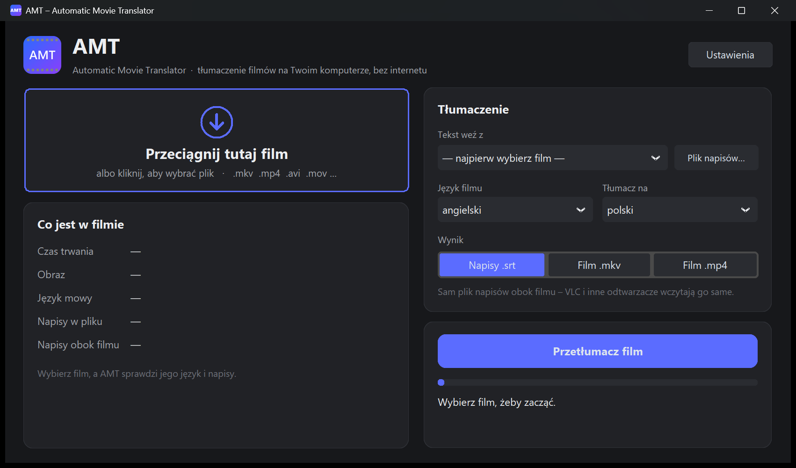

# AMT – Automatic Movie Translator

Tłumacz filmów, który działa **w całości na Twoim komputerze** (Windows, macOS, Linux).
Wrzucasz film, a AMT wykrywa język i napisy, tłumaczy je i zapisuje napisy `.srt`
albo od razu gotowy film z napisami (`.mkv` lub `.mp4`).

Bez kont i bez chmury: nic nie jest wysyłane do internetu. Sieć jest potrzebna tylko raz,
do pobrania bibliotek i modeli.



> Do oglądania na żywo (Netflix, YouTube, VLC) służy siostrzany program
> **AMTSB – Automatic Movie Translator SuBtitles**: zakrywa napisy na ekranie tłumaczeniem.

## Co potrafi

- **Wykrywa** język mowy (Whisper), napisy wbudowane w plik (ścieżki tekstowe MKV/MP4)
  i pliki napisów leżące obok filmu (`Film.en.srt` itp.).
- **Tłumaczy**:
  - gotowe napisy z filmu albo z pliku `.srt` / `.ass` / `.vtt`. To najszybsza i najdokładniejsza
    opcja: cały film w 1–3 minuty;
  - mowę, gdy film nie ma żadnych napisów: rozpoznaje dialogi i tworzy napisy od zera.
- **Zapisuje**:
  - `Film.pl.srt`, który VLC i inne odtwarzacze wczytują same;
  - `Film [PL].mkv`, czyli film z dodaną ścieżką napisów: bez ponownego kodowania i bez utraty jakości;
  - `Film [PL].mp4` z napisami wtopionymi w obraz, który działa na każdym telewizorze i telefonie.
    Obraz koduje karta graficzna, jeśli jest dostępna (Intel Quick Sync, NVIDIA, AMD, Apple VideoToolbox).
- 36 języków (NLLB-200): polski, angielski, niemiecki, hiszpański, francuski, włoski, rosyjski,
  ukraiński, czeski, japoński, koreański, chiński i inne.
- Film można przeciągnąć na okno.
- Okno dopasowuje się do powiększenia ekranu ustawionego w systemie (np. 150% w Windows).
  W **Ustawieniach** można je dodatkowo powiększyć lub pomniejszyć (90–125%).

## Instalacja i uruchomienie

Potrzebny jest [Python 3.11 lub 3.12](https://www.python.org/downloads/) oraz ok. 2–3 GB miejsca
na biblioteki i modele (wspólne z AMTSB). Karta NVIDIA nie jest potrzebna, bo wszystko działa na procesorze.

Najpierw pobierz repozytorium (**Code → Download ZIP**) i rozpakuj, albo `git clone`.

| System | Uruchomienie |
|---|---|
| **Windows 10/11** | dwuklik na **`AMT.exe`** (ikona aplikacji). Przy instalacji Pythona zaznacz *Add python.exe to PATH*. |
| **macOS** | dwuklik na **`AMT.app`** (ikona aplikacji) albo `AMT.command`. Za pierwszym razem: prawy klik → *Otwórz*. |
| **Linux** | za pierwszym razem `bash amt.sh` w terminalu. Potem AMT jest w menu aplikacji (z ikoną). Wcześniej: `sudo apt install python3 python3-venv python3-tk ffmpeg` |

Przy pierwszym uruchomieniu program utworzy środowisko w `~/.amt` (Windows: `%USERPROFILE%\.amt`)
i zainstaluje biblioteki (kilka minut, w widocznym oknie). Przy pierwszym tłumaczeniu pobierze modele
(ok. 0,6–1,1 GB). Film można też przeciągnąć prosto na `AMT.exe`.

> **Windows SmartScreen:** `AMT.exe` to mały program startowy bez podpisu cyfrowego, więc po pobraniu z internetu
> Windows może pokazać „System Windows ochronił ten komputer”. Kliknij *Więcej informacji → Uruchom mimo to*.
> Kod źródłowy jest w `launcher/launcher.cs`, a `launcher/build.bat` buduje go od nowa. Zamiast `AMT.exe`
> możesz też używać `AMT.bat`.

Tryb bez okna, np. do skryptów:

```bash
python amt.py --srt "Film.mkv" tgt=pl export=mkv
python amt.py --srt "Film.mkv" source=whisper export=srt
python amt.py --srt "Film.mkv" source="Film.en.srt" export=mp4
```

## Różnice między systemami

| | Windows | macOS | Linux |
|---|---|---|---|
| Okno, tłumaczenie, rozpoznawanie mowy | ✔ | ✔ | ✔ |
| Film `.mkv` z napisami | ✔ | ✔ | ✔ |
| Film `.mp4` z wtopionymi napisami | ✔ (Quick Sync / NVENC / AMF) | ✔ (VideoToolbox)¹ | ✔ (NVENC / Quick Sync / procesor)¹ |
| Przeciąganie pliku na okno | ✔ | ✔ | ✔ |

Stan testów: na Windows wszystko jest przetestowane. Wersje na macOS i Linuksa są gotowe, ale nie były jeszcze
sprawdzone na prawdziwym Macu ani komputerze z Linuksem.

¹ Jeśli w systemie jest zainstalowany `ffmpeg` (`brew install ffmpeg` / `sudo apt install ffmpeg`), AMT używa właśnie
jego. W przeciwnym razie używa wbudowanego z pakietu imageio-ffmpeg.

## Jak to działa

| Krok | Narzędzie |
|---|---|
| Odczyt filmu, ścieżek dźwięku i napisów | PyAV, FFmpeg |
| Rozpoznawanie mowy i języka | [faster-whisper](https://github.com/SYSTRAN/faster-whisper) (Whisper, CTranslate2, int8 na procesorze) |
| Tłumaczenie | [NLLB-200](https://ai.meta.com/research/no-language-left-behind/) distilled 600M / 1.3B (CTranslate2) |
| Zapis filmu | FFmpeg, libass, koder sprzętowy albo libx264 |
| Okno | [CustomTkinter](https://github.com/TomSchimansky/CustomTkinter), tkinterdnd2 |

Przykładowe czasy na laptopie z Intel i5-1135G7, bez karty NVIDIA:

- tłumaczenie gotowych napisów: ok. 0,1 s na kwestię, czyli cały film w kilka minut;
- rozpoznawanie mowy (model *small*): ok. 5× szybciej niż czas trwania filmu;
- film `.mp4` z wtopionymi napisami (Quick Sync, 720p): ok. 10× szybciej niż czas trwania filmu.

## Pliki

| Co | Gdzie |
|---|---|
| Biblioteki Pythona | `~/.amt/venv` |
| Modele | `~/.amt/models` |
| Ustawienia i log | `~/.amt/amt.json`, `~/.amt/amt.log` |

W Windows `~` to `%USERPROFILE%`. Inny folder można ustawić zmienną środowiskową `AMT_HOME`.
Odinstalowanie polega na usunięciu folderu programu i `~/.amt`.

## Licencje modeli i bibliotek

- Whisper (OpenAI), faster-whisper, CTranslate2, CustomTkinter, tkinterdnd2: MIT
- **NLLB-200 (Meta): CC-BY-NC 4.0, tylko do użytku niekomercyjnego**
- FFmpeg: LGPL/GPL (zależnie od wersji)

Modele nie są częścią repozytorium. Program pobiera je z Hugging Face przy pierwszym użyciu.

## Licencja

Kod programu: [GNU AGPL v3](LICENSE). Modele i biblioteki mają własne licencje (patrz wyżej).


## Kontakt

W przypadku pytań proszę pisać na adres: blazejstosio@sinusoide.pl
